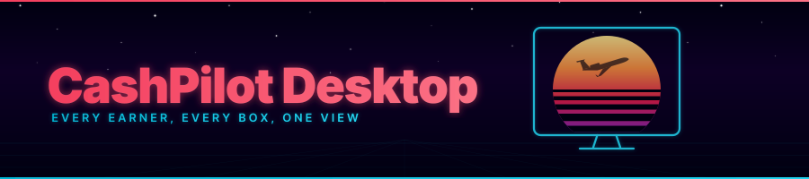
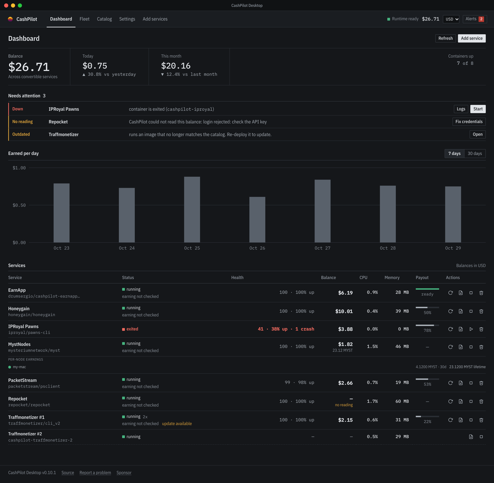

  

  
  
  
  
  

<strong>Every earner, every box, one view.</strong> <a href="https://cashpilot.club">cashpilot.club</a> · <a href="https://x.com/CashPilotClub">@CashPilotClub on X</a>

CashPilot Desktop is CashPilot as a desktop app for macOS (Apple Silicon), Windows and Linux. It deploys and tracks the software that earns from your spare bandwidth, compute and disk (bandwidth sharing, DePIN nodes, crypto mining, GPU compute and storage). CashPilot can fence the apps it runs off your home network, so they reach the internet and nothing else. It runs as the full CashPilot dashboard (Run everything here) or as one more box in a CashPilot fleet you already have (Join my CashPilot). Earners with a container image run in Docker or Podman, and the app tracks the browser-extension and desktop-only ones.

  

CashPilot Desktop is at 2.0 and does not update itself: get new versions from the [releases page](https://github.com/GeiserX/CashPilot-Desktop/releases). What changed in each major version, and the steps to upgrade: [UPGRADING.md](UPGRADING.md).

## Features

- **One-click deploys** -- Pick an earner with a container image from the catalog and the app sets up its container; the wizard helps you install Docker
- **LAN isolation** -- The app can fence earners off your home network, so they reach the internet and nothing else: not your LAN, a tailnet, cloud metadata, this computer or your public IPs ([docs](docs/configuration.md#lan-isolation))
- **One fleet** -- Join your CashPilot server as one more box, or be the hub that Docker workers and the [Android companion](https://github.com/GeiserX/CashPilot-android/releases) report to
- **Server commands** -- Your CashPilot server (3.0.0 or newer) can deploy, stop and remove services here, behind a switch ([docs](docs/configuration.md#the-server-starts-and-stops-services-here))
- **Real-time monitoring** -- Live earnings, service health, container stats and node uptime, with a menu-bar summary on macOS
- **Activity (opt-in)** -- Which destinations each earner talks to, and whether it reaches into your network or sends mail; remote addresses kept 24 hours ([details](docs/activity.md))
- **Proxied copies** -- Run extra copies through a SOCKS5, HTTP CONNECT or Tailscale exit-node proxy, so one computer earns on several IPs ([docs](docs/proxies.md))
- **Node identities kept safe** -- Removing a service keeps its data, and encrypted backups take one click ([docs](docs/backup.md))
- **Provider grades** -- Every catalog provider gets a letter grade on the web app's published criteria ([how we grade](https://geiserx.github.io/CashPilot/ratings/))
- **Secure storage** -- Credentials encrypted at rest with AES-256-GCM and the master key in the OS keychain; the macOS build is signed and notarized by Apple

## Quick start

1. Download the app from the [latest release](https://github.com/GeiserX/CashPilot-Desktop/releases/latest). Docker or Podman must be installed; the wizard helps if it is missing.
   - **CashPilot Desktop for Windows**: the installer, `CashPilot-Desktop-windows-amd64-setup.exe`. It installs for your account with no admin prompt and adds an uninstaller to Settings > Apps. The portable `CashPilot-Desktop-windows-amd64.exe` runs from any folder and installs nothing. Both use the same data.
   - **CashPilot Desktop for macOS**: `CashPilot-Desktop-darwin-arm64.zip`, for Apple silicon.
   - **CashPilot Desktop for Linux**: `CashPilot-Desktop-linux-amd64.tar.gz`, for x64.
2. Launch the app and pick how it runs: **Run everything here** (it collects your earnings and shows the dashboard) or **Join my CashPilot** (paste the block from your CashPilot's Fleet page, Add a box; the app tests the connection before it saves anything).
3. Browse the service catalog, deploy containers, and watch earnings from the dashboard or the tray.

Platform notes, system requirements and the full walkthrough are in [Getting started](docs/getting-started.md).

## Supported services

CashPilot bundles a catalog of 49 active services in five groups: bandwidth sharing, DePIN, GPU compute, crypto mining and storage (the catalog also carries 11 retired entries, which the app hides and refuses to deploy). Some links below are affiliate/referral links -- see the [disclosure](docs/services.md#disclosure). Read [how bandwidth-sharing works](docs/services.md#before-you-start-how-bandwidth-sharing-works) before you opt in; per-service limits, payouts and caveats are in [docs/services.md](docs/services.md).

- **Docker-deployable:** [Anyone Protocol](https://anyone.io), [Bitping](https://app.bitping.com), [Earn.fm](https://earn.fm/ref/GEISYB91), [EarnApp](https://earnapp.com/i/TSMD9wSm), [Honeygain](https://dashboard.honeygain.com/ref/SERGIB4014), [IPRoyal Pawns](https://pawns.app?r=19266874), [MystNodes](https://mystnodes.co/?referral_code=do7v7YOoBBpbOstKQovX2pUvZYKia4ZhH3QIdNtE), [PacketStream](https://packetstream.io/?psr=7xgZ), [ProxyBase](https://peer.proxybase.org/dashboard/signup?referral=nXzS3c6iTO), [ProxyBase Markets](https://proxybase.xyz?referral=nXzS3c6iTO), [ProxyLite](https://proxylite.ru/?r=KMUPRZIZ), [ProxyRack](https://peer.proxyrack.com/ref/mpwiok3xlaxeycnn5znqlg7ipjeutxyxr6xl7vmn), [Repocket](https://link.repocket.com/b1zM), [Sia hostd](https://docs.sia.tech/provide-storage/setting-up-hostd/docker), [Storj](https://storj.dev/node/get-started/setup), [Traffmonetizer](https://traffmonetizer.io/?aff=2111758), [URnetwork](https://ur.io/c?bonus=1Q3G19)
- **Browser extension / desktop only:** [Bytebenefit](https://bytebenefit.io/invited?ref=Brl4z3), [Bytelixir](https://bytelixir.com/r/OYEIRE0VSZBZ), [Dawn Internet](https://infrastructure.finance/validator-extension?code=2QLQV97F), [Deeper Network](https://shop.deeper.network?sca_ref=12020100.q8Vxm3SliA), [Ebesucher](https://www.ebesucher.com/?ref=geiserx), [Grass](https://app.grass.io/register?referralCode=kn8FNEPnUr2tMqE), [Helium](https://helium.com), [Nodepay](https://app.nodepay.ai/register?ref=0wzzyznen64j9zx), [Noderr Micronodes](https://micronodes.noderr.xyz/), [Nodle](https://nodle.com), [PassiveApp](https://passiveapp.com/i/bqpC4M), [Sentinel dVPN](https://sentinel.co), [Spide](https://spide.network/register.html?f3bc51), [Teneo Protocol](https://dashboard.teneo.pro/auth/signup?referralCode=CAqef), [Theta Edge Node](https://thetatoken.org), [Titan Network](https://edge.titannet.info/signup?inviteCode=2GKKJ495), [Uprock](https://link.uprock.com/i/33e8492e), [Wipter](https://wipter.com/register?via=FB1373FBDA)
- **GPU compute:** [Flux](https://runonflux.io), [Golem Network](https://golem.network), [io.net](https://io.net), [Nosana](https://nosana.io), [Salad](https://salad.io), [Vast.ai](https://cloud.vast.ai/?ref_id=452772)
- **Crypto mining:** [2Miners ETC](https://etc.2miners.com/help) (unpaid ETC balance), [HeroMiners Kaspa](https://kaspa.herominers.com/?lang=en) (unpaid KAS balance), [Kryptex Pool (Pearl)](https://pool.kryptex.com/?ref=2444cca8) (NVIDIA GPU, balance kept in your Kryptex account), [OCEAN](https://ocean.xyz/getstarted) (unpaid BTC balance), [SRBMiner-Multi (GPU mining)](https://github.com/doktor83/SRBMiner-Multi/releases) (NVIDIA GPU, fee shown before deploy), [SupportXMR](https://supportxmr.com) (unpaid XMR balance), [unMineable (CPU mining, paid in your coin)](https://unmineable.com/?ref=awk6-j1z0) (unpaid balance in your coin), [XMRig (Monero CPU mining)](https://xmrig.com) (fee shown before deploy)

> Dawn Internet's link does not pass the code on. Create the account in the DAWN Validator extension and enter referral code `2QLQV97F` when it asks.

## Documentation

- [Getting started](docs/getting-started.md): modes, downloads, system requirements, Desktop vs Web
- [Configuration](docs/configuration.md): every setting and its default, joining a CashPilot server, where secrets live
- [Usage](docs/usage.md): a tour of every screen
- [Activity](docs/activity.md): what the opt-in Activity page reads, keeps and alerts on
- [Supported services](docs/services.md): bandwidth-sharing explained, per-service limits and payouts, disclosure
- [Custom services](docs/custom-services.md): run an image the catalog does not list, and what it may do
- [Proxied copies](docs/proxies.md): run extra copies through a proxy, what cannot, the traffic cap, Tailscale exit nodes
- Moving from another tool: [money4band](docs/migrate/money4band.md), [CashFactory](docs/migrate/cashfactory.md), [InternetIncome](docs/migrate/internetincome.md)
- [How it works](docs/how-it-works.md): the full design, grounded in the code
- [FAQ](docs/faq.md): earnings, safety, Docker, crashes, several machines
- [Development](docs/development.md): prerequisites, dev workflow, build, tests
- [For AI agents](https://geiserx.github.io/CashPilot/for-ai-agents/): how an AI assistant can offer CashPilot's referral sign-ups to its user

## Related projects

| Project | Type | Description |
|---------|------|-------------|
| [CashPilot](https://github.com/GeiserX/CashPilot) | Server | Self-hosted dashboard and Docker worker for every earner and every box |
| [CashPilot-android](https://github.com/GeiserX/CashPilot-android) | Android agent | Watches the earning apps on your phone and reports them to your fleet |
| [cashpilot-mcp](https://github.com/GeiserX/cashpilot-mcp) | MCP server | Gives your AI agent your earnings, your fleet and control of your earners |
| [cashpilot-ha](https://github.com/GeiserX/cashpilot-ha) | Home Assistant | Earnings and service status sensors for your smart home |

## License

[GPL-3.0-or-later](LICENSE). Sergio Fernandez, 2026.
