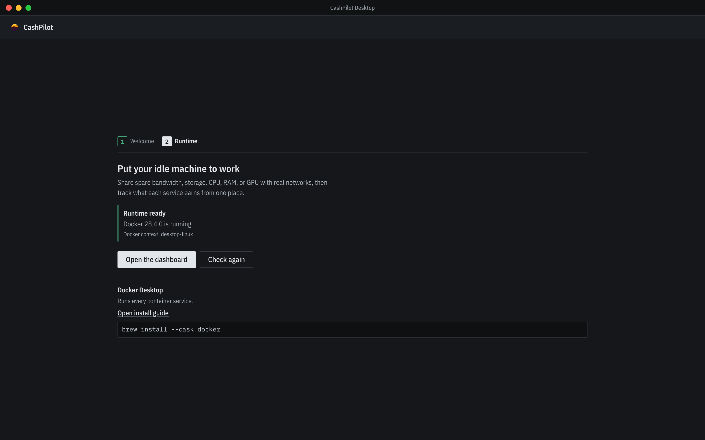
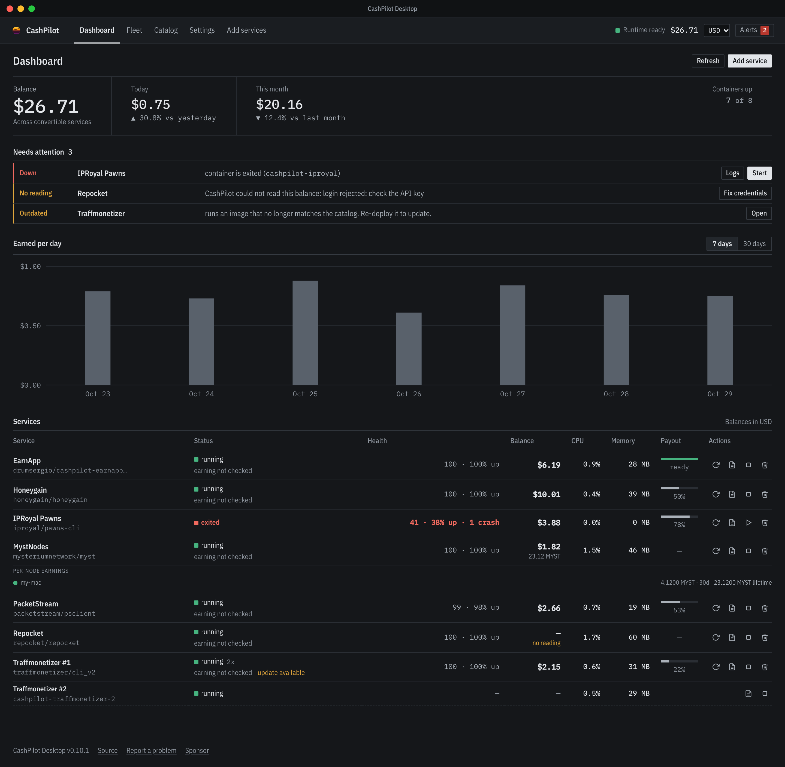
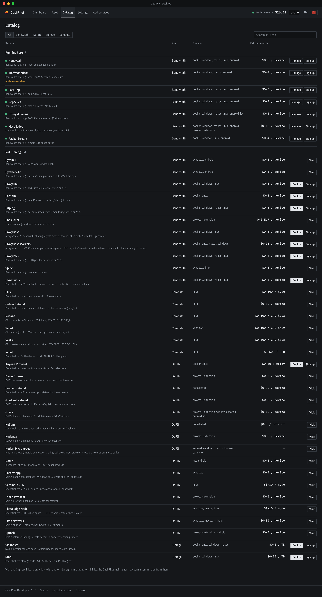
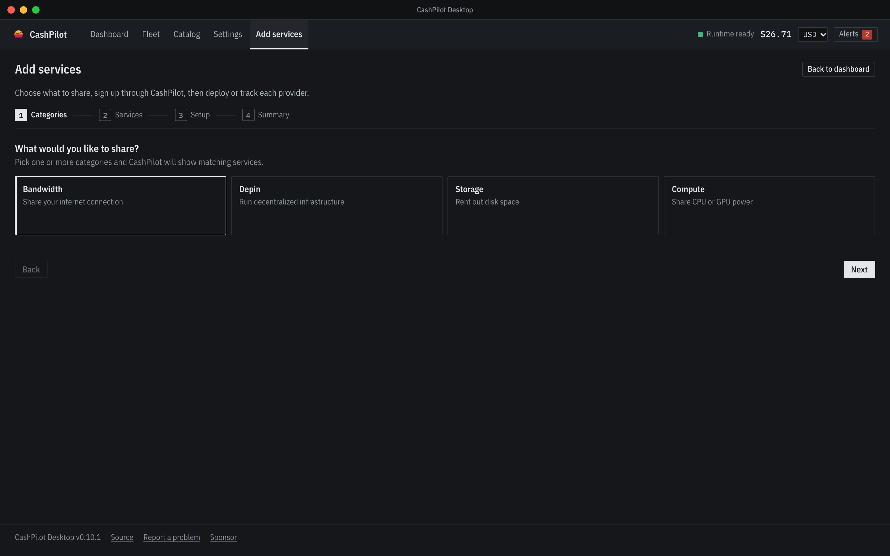
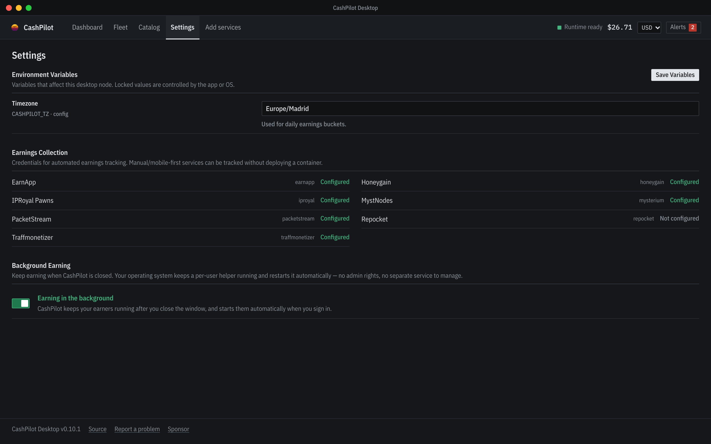
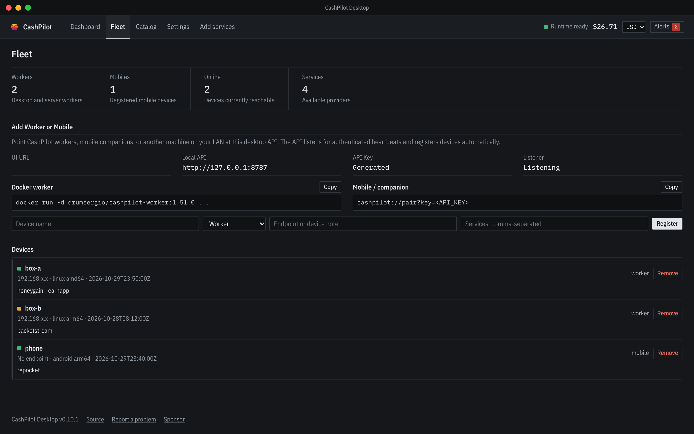

# Usage

A visual tour of the app's console layout, captured from the app's frontend with
sample data: seven services on the local Docker runtime (one stopped, one with a
collector that cannot log in), a month of made-up earnings history, and three
example fleet devices. None of the
balances, credentials or devices are real. Where a screen displayed a
locally-generated API token, a LAN IP, a hostname or a home path, those values are
masked (`<API_KEY>`, `192.168.x.x`, `my-mac`, `/Users/you/`). The loopback
`127.0.0.1` is kept so the fleet/API addresses stay accurate.

## Onboarding

First launch welcomes you and then checks for a container runtime, with
copy-paste install guides for Docker, Colima, Lima, and Podman across macOS,
Linux, and Windows.

## Dashboard

The home view, in the order you need it. The balance, today's and this month's
earnings come first, with the count of containers up at the far end. Next is
**Needs attention**: every stopped container, unreadable balance or outdated image,
each with the button that fixes it (Start, Fix credentials, Open). Then the earnings
per day over 7 or 30 days, and the services table with status, health, balance, CPU,
memory and how far each balance is from its cash-out minimum. A platform CashPilot
reads a balance for but does not run on this machine keeps its row there too.

## Catalog

Browse the built-in catalog of passive-income and DePIN providers (bandwidth,
DePIN, storage, and compute) as one table: the services running here first, then the
rest, each with where it runs, its estimated monthly earnings and a path into
**Add services**.

## Add services

A guided flow — pick categories, choose providers, enter credentials, and deploy —
so you don't have to hand-write container configs.

### A service's image

Each service runs from the image its catalog entry names, pinned by digest. To run
it from another one, expand **Advanced** on the service's card and type the image
in the **Image** box: a registry mirror, or a community build for an architecture
the provider does not publish.

- Blank means the catalog image. Clearing the box and deploying goes back to it.
- The choice is saved with the deployment, and every redeploy keeps it until you
  clear the box. Removing the service forgets it.
- Only the image changes. Capabilities, devices, ports, the entrypoint and the stop
  timeout still come from the catalog entry, so a custom image gets nothing the
  service does not already have. It does receive the service's credentials, so use
  an image you trust.
- The dashboard and the catalog mark such a deployment **custom image** and judge
  "update available" against the image you chose, not the catalog's.

### Running a service more than once

Set **Instances** on the service's card and deploy. Each extra copy is its own
container (`cashpilot-<service>-2`, `-3`, ...) and registers with the provider as its
own device: every device name the catalog derives from this computer's name gets
`-2`, `-3` added.

- Providers count devices per public IP, and copies on one machine share its
  connection. Extra copies add devices, not bandwidth, so they only help where the
  provider pays per device and allows several per IP. Where a provider allows one
  device per IP the box is locked at 1, with the reason under it; run the service on
  machines on other connections instead.
- A service that keeps data in a host directory or publishes a host port runs once,
  because its copies would share the directory and fight over the port. So does a
  service that runs here as a program rather than a container.
- The count is saved with the deployment and kept by every redeploy. Lowering it
  removes the highest copies first; removing the service removes all of them. If a
  provider later stops allowing several copies, the next redeploy runs what is
  allowed and removes the rest.
- Each copy has its own row on the dashboard (`#2`, `#3`, ...) with its own Logs and
  Stop or Start. The balance stays on the service's first row, since the copies earn
  into one account.
- At most 10 copies.

## Settings

Configure the display currency, collection interval, data retention, and per-service
credentials. Credentials are encrypted at rest with a master key held in the OS
keychain.

## Fleet

Run CashPilot across more than one machine: point workers or a mobile companion at
the desktop's loopback API and they register automatically. Silent devices are
flipped offline and long-dead ones are reaped, so the list stays honest.

